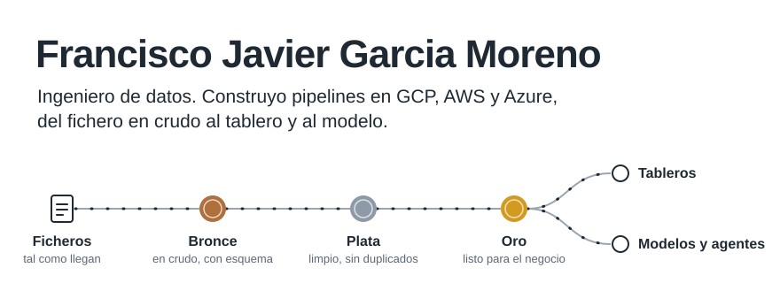

<picture>
  <source media="(prefers-color-scheme: dark)" srcset="assets/pipeline-es-dark.svg">
  
</picture>

[English](README.md) | Español

**Datos que llegan a tiempo, limpios y listos para decidir.**

Detrás de cada buena decisión hay un dato en el que alguien confió. Mi trabajo es que ese dato merezca esa confianza. Los datos no fallan por falta de herramientas: fallan porque nadie diseñó el camino. Yo diseño ese camino. Tomo información dispersa, la ordeno, la valido y la dejo lista para que el negocio decida sin dudar, en pipelines que se operan solos, se prueban solos y no esconden errores.

[Portafolio](https://javiermorenof7.github.io/cv_portafolio/) | [LinkedIn](https://www.linkedin.com/in/francisco-javier-garcia-moreno)

## Proyectos

Cada carpeta de este repositorio es un caso que resolví de principio a fin. Seis procesan datos públicos reales (vigilancia en salud pública, tasas de interés, ventas minoristas, ausentismo y PIB), con la fuente y la licencia en su README; los otros cuatro usan datos ficticios.

### Pipelines en Google Cloud

| Proyecto | Qué hace |
| --- | --- |
| [Pipeline de datos de FinTrust](caso_gcp_fintrust) | Sustituye las descargas manuales de reportes de una fintech de crédito de consumo por un pipeline automatizado en BigQuery, con las decisiones técnicas y la evidencia de calidad de datos documentadas. |
| [Ingesta de datos de salud](analisis_gcp) | Carga ficheros CSV, TXT y Excel desde Cloud Storage a las capas bronce y plata de BigQuery. Lo orquesta Cloud Composer (Airflow) y todas las cargas son idempotentes. |
| [Seguros AltaVida](seguros_altavida) | Procesamiento de datos, machine learning y una arquitectura en la nube para llevar la analítica de una aseguradora de salud de soluciones puntuales a producción. |
| [Arquitectura de ventas](area_ventas) | Lleva un libro de ventas de un Excel local a una arquitectura escalable en Google Cloud. |

### Pipelines en AWS

| Proyecto | Qué hace |
| --- | --- |
| [Calendarios académicos en Databricks](calendarios_databricks_aws) | Lleva los calendarios que las universidades aliadas dejan en S3 por las capas bronce, plata y oro en tablas Delta de Databricks. Los ficheros que no han cambiado se omiten y las filas que no se pueden usar se apartan con su motivo. |

### IA

| Proyecto | Qué hace |
| --- | --- |
| [Agente de banca y e-commerce](ecomerce_agent) | Un asistente que compara el precio de un producto con el saldo del cliente antes de recomendarlo. Combina búsqueda semántica en el catálogo (FAISS) con los datos del propio cliente, y está hecho con LangChain. |

### Análisis

| Proyecto | Qué hace |
| --- | --- |
| [Riesgo de crédito](riesgo_credito) | Tasas de intermediación de la banca por tipo de entidad, tipo de crédito y plazo, para apoyar una estrategia de fondeo. |
| [Ausentismo en una fábrica](analisis_company) | Un modelo dimensional y una tabla única de análisis para explicar cómo afectan las ausencias a la productividad. |
| [Recomendación de productos](analisis_probabilistico_tiendas) | Un análisis probabilístico de si un producto es una buena recomendación para otro. |
| [Limpieza y transformación](limpieza_trasformacion) | Un notebook que convierte un Excel desordenado en un conjunto de datos limpio. |

## Cómo se opera

- Cada carpeta es un proyecto independiente con su propio README: qué resuelve, cómo ejecutarlo y sus datos de ejemplo.
- Entorno: Python 3.12 y `pip install -r requirements.txt` en un entorno virtual. Los proyectos en la nube (Google Cloud, Databricks) necesitan además su cuenta y su configuración, descritas en su README.
- Cada push a `main` pasa por el CI: comprueba la sintaxis de todos los archivos de Python y que todos los notebooks sean válidos.

## Herramientas

| Área | Qué uso |
| --- | --- |
| Lenguajes | Python, SQL, Scala, PySpark |
| Plataformas de datos | Databricks, BigQuery, Delta Lake, Unity Catalog, Redshift, Synapse, PostgreSQL |
| Nube | Google Cloud, AWS, Azure |
| Orquestación | Airflow (Cloud Composer, MWAA), Azure Data Factory, jobs de Databricks |
| Analítica e IA | Power BI, Tableau, Looker Studio, Pandas, Scikit-learn, NLTK, LangChain, FAISS, Vertex AI |
| Prácticas | Arquitectura medallón, carga incremental con MERGE, cargas idempotentes, calidad de datos, modelado dimensional (estrella), pruebas SQL automáticas, Git y merge requests |
