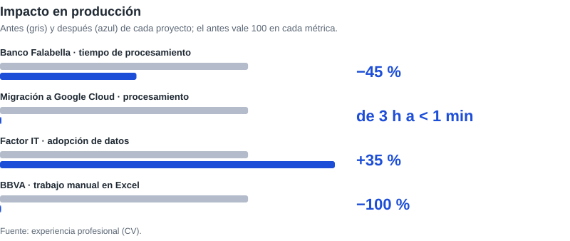
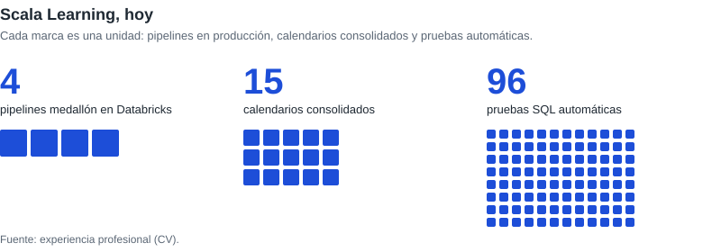
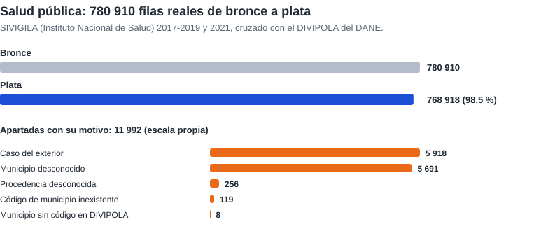
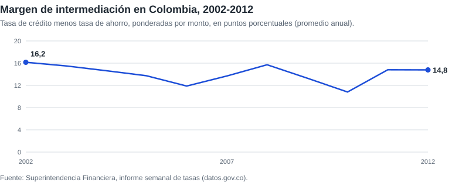
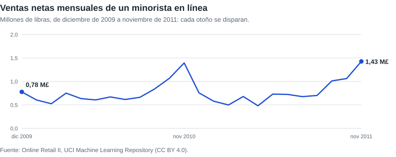
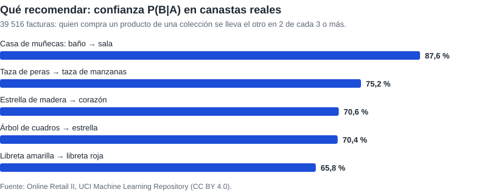
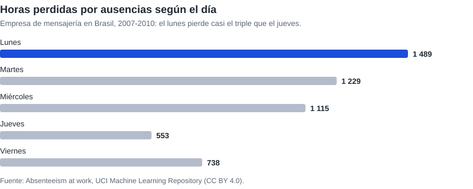
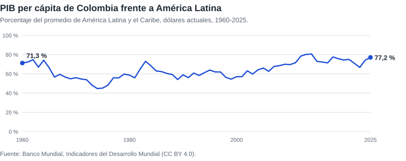
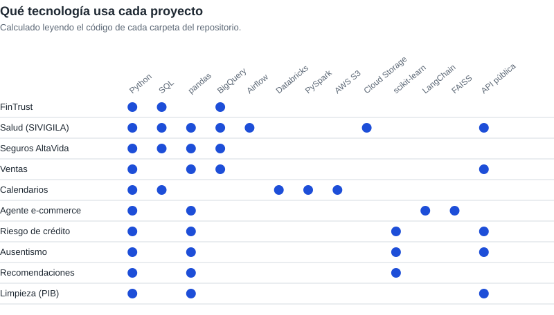

<picture>
  <source media="(prefers-color-scheme: dark)" srcset="assets/pipeline-es-dark.svg">
  
</picture>

[English](README.md) | Español

**Datos que llegan a tiempo, limpios y listos para decidir.**

Detrás de cada buena decisión hay un dato en el que alguien confió. Mi trabajo es que ese dato merezca esa confianza. Los datos no fallan por falta de herramientas: fallan porque nadie diseñó el camino. Yo diseño ese camino. Tomo información dispersa, la ordeno, la valido y la dejo lista para que el negocio decida sin dudar, en pipelines que se operan solos, se prueban solos y no esconden errores.

[Portafolio](https://javiermorenof7.github.io/cv_portafolio/) | [LinkedIn](https://www.linkedin.com/in/francisco-javier-garcia-moreno)

<picture>
  <source media="(prefers-color-scheme: dark)" srcset="assets/impacto-es-dark.svg">
  
</picture>

<picture>
  <source media="(prefers-color-scheme: dark)" srcset="assets/scala-es-dark.svg">
  
</picture>

## Proyectos con datos públicos reales

Seis carpetas procesan datos públicos reales, de la fuente a las capas bronce, plata y oro. Cada descarga es idempotente (si la fuente no cambió, no se vuelve a bajar), cada regla que aparta filas deja su motivo y cada capa comprueba que no se pierde nada respecto a la anterior. La fuente y la licencia están en el README de cada proyecto.

### [Vigilancia en salud pública](analisis_gcp)

Casos semanales del SIVIGILA (Instituto Nacional de Salud) de 2017 a 2021, cruzados con el maestro de municipios del DANE. Cada año llega con un esquema distinto, los códigos sin ceros a la izquierda y, en 2021, solo con nombres: el pipeline los unifica y busca el código de cada municipio por su nombre.

<picture>
  <source media="(prefers-color-scheme: dark)" srcset="assets/flujo-sivigila-es-dark.svg">
  
</picture>

### [Tasas de interés en Colombia](riesgo_credito)

Veinte años del informe semanal de tasas de la Superintendencia Financiera (732 673 filas): codificación reparada, duplicados por cambio de nombre de una entidad y tasas ponderadas por monto.

<picture>
  <source media="(prefers-color-scheme: dark)" srcset="assets/margen-intermediacion-es-dark.svg">
  
</picture>

### [Ventas de un minorista en línea](area_ventas)

Un millón de líneas de factura reales de Online Retail II. El hallazgo que más pesa: el libro repite en sus dos hojas las ventas del 1 al 9 de diciembre de 2010, que sin esa regla se contarían dos veces.

<picture>
  <source media="(prefers-color-scheme: dark)" srcset="assets/ventas-mensuales-es-dark.svg">
  
</picture>

### [Qué recomendar con canastas reales](analisis_probabilistico_tiendas)

Confianza, lift e intervalo de Wilson al 95 % sobre 39 516 facturas reales para decidir si el producto A es una buena recomendación para el B.

<picture>
  <source media="(prefers-color-scheme: dark)" srcset="assets/recomendaciones-es-dark.svg">
  
</picture>

### [Ausentismo](analisis_company) y [limpieza de datos](limpieza_trasformacion)

Un modelo dimensional con 740 ausencias reales (UCI) y la limpieza del PIB per cápita del Banco Mundial, que llega con los años en columnas y las regiones mezcladas con los países.

<picture>
  <source media="(prefers-color-scheme: dark)" srcset="assets/ausentismo-es-dark.svg">
  
</picture>

<picture>
  <source media="(prefers-color-scheme: dark)" srcset="assets/pib-colombia-es-dark.svg">
  
</picture>

## Proyectos demostrativos

Casos con datos ficticios: los datos de clientes, afiliados o salarios nunca son públicos.

| Proyecto | Qué hace |
| --- | --- |
| [Pipeline de datos de FinTrust](caso_gcp_fintrust) | Reemplaza las descargas manuales de reportes de una fintech de crédito de consumo por un pipeline automatizado en BigQuery, con decisiones técnicas documentadas y evidencia de calidad de datos. |
| [Calendarios académicos en Databricks](calendarios_databricks_aws) | Lleva los calendarios que las universidades aliadas dejan en S3 por tablas bronce, plata y oro en Databricks. Los archivos que no cambian se omiten y las filas que no sirven se apartan con su motivo. |
| [Seguros AltaVida](seguros_altavida) | Procesamiento de datos, machine learning y una arquitectura en la nube para llevar la analítica de una aseguradora de salud de soluciones puntuales a producción. |
| [Agente de banca y e-commerce](ecomerce_agent) | Un asistente que compara el precio de un producto con el saldo del cliente antes de recomendarlo. Combina búsqueda semántica sobre el catálogo (FAISS) con los datos del cliente, hecho con LangChain. |

## Tecnologías

<picture>
  <source media="(prefers-color-scheme: dark)" srcset="assets/matriz-tecnologias-es-dark.svg">
  
</picture>

| Área | Qué uso |
| --- | --- |
| Lenguajes | Python, SQL, Scala, PySpark |
| Plataformas de datos | Databricks, BigQuery, Delta Lake, Unity Catalog, Redshift, Synapse, PostgreSQL |
| Nube | Google Cloud, AWS, Azure |
| Orquestación | Airflow (Cloud Composer, MWAA), Azure Data Factory, jobs de Databricks |
| Analítica e IA | Power BI, Tableau, Looker Studio, Pandas, Scikit-learn, NLTK, LangChain, FAISS, Vertex AI |
| Prácticas | Arquitectura medallón, carga incremental con MERGE, cargas idempotentes, calidad de datos, modelado dimensional (estrella), pruebas SQL automáticas, Git y merge requests |

## Formación

- Máster Universitario en Sistemas Integrados de Gestión (Ingeniería de Datos), Universidad Internacional de La Rioja (UNIR), 2018-2020.
- Ingeniero Industrial, Universidad Jorge Tadeo Lozano, 2014-2018.
- Certificación Data Engineer, Platzi, 2021.

## Cómo se opera

- Cada carpeta es un proyecto independiente con su propio README: qué resuelve, cómo ejecutarlo y sus datos.
- Entorno: Python 3.12 y `pip install -r requirements.txt` en un entorno virtual. Los proyectos en la nube (Google Cloud, Databricks) necesitan además su cuenta y su configuración, descritas en su README.
- En los proyectos con datos reales, un script de ingesta baja la fuente y otro arma las capas. Las descargas y la capa plata se regeneran y no se versionan; la capa oro y una muestra de bronce sí.
- Cada push a `main` pasa por el CI: comprueba la sintaxis de todos los archivos de Python y que todos los notebooks sean válidos.
