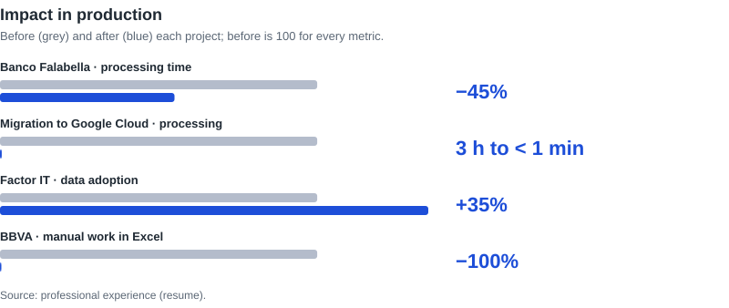
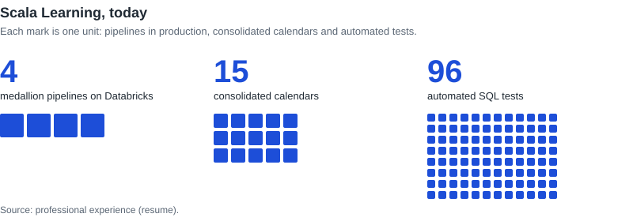
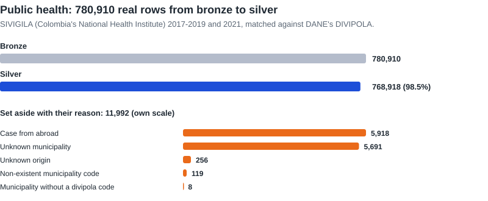
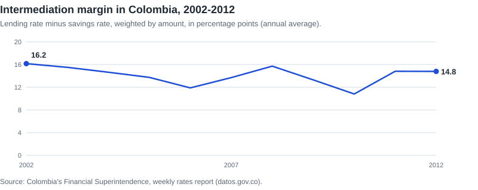
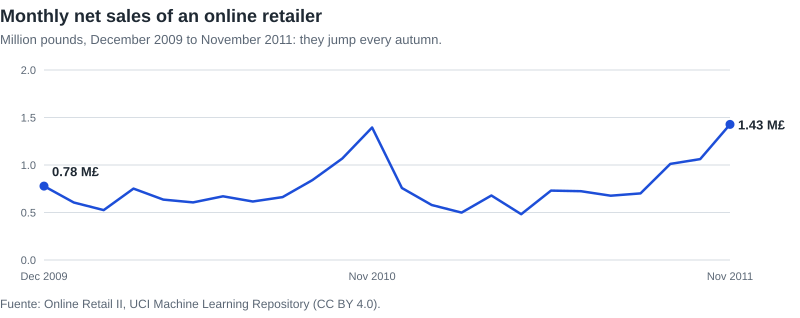
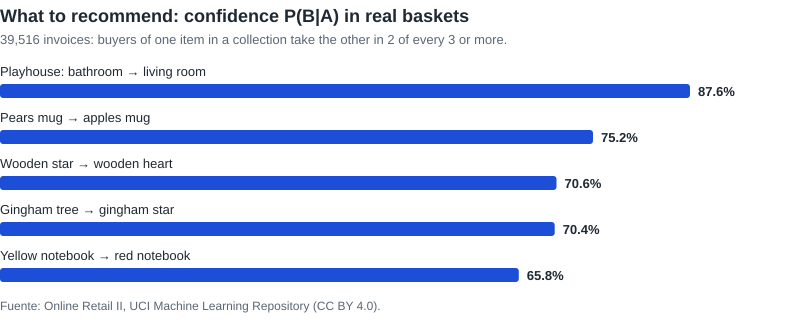
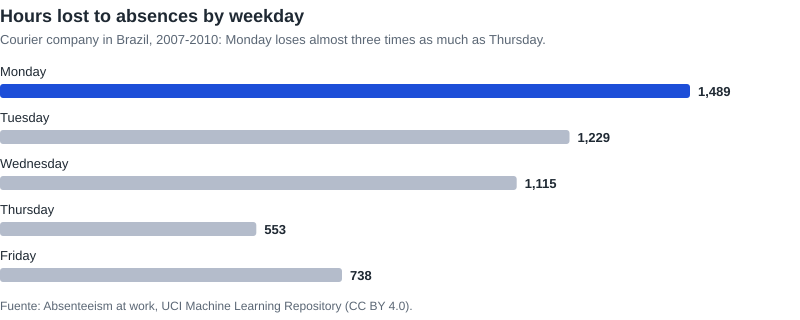
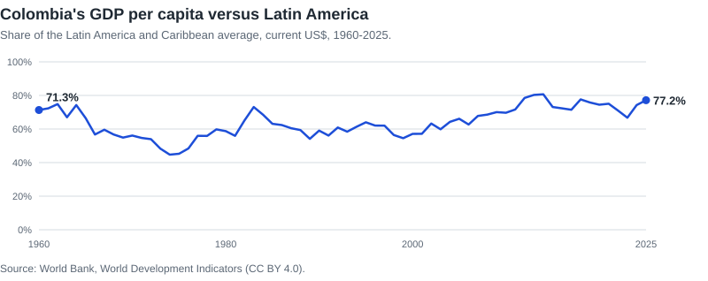
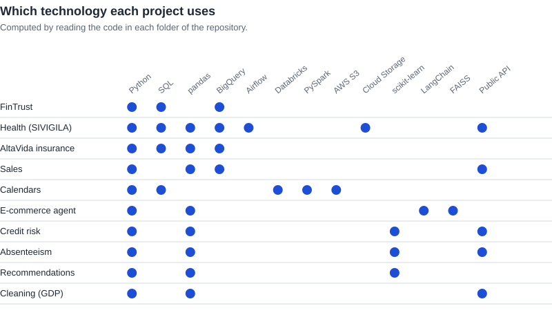

<picture>
  <source media="(prefers-color-scheme: dark)" srcset="assets/pipeline-en-dark.svg">
  
</picture>

English | [Español](README.es.md)

**Data that arrives on time, clean and ready for decisions.**

Behind every good decision there is a piece of data someone trusted. My job is to make that data worth the trust. Data doesn't fail for lack of tools; it fails because no one designed the path. I design that path. I take scattered information, organize it, validate it and make it ready for the business to decide with confidence, in pipelines that run themselves, test themselves and hide no errors.

[Portfolio](https://javiermorenof7.github.io/cv_portafolio/) | [LinkedIn](https://www.linkedin.com/in/francisco-javier-garcia-moreno)

<picture>
  <source media="(prefers-color-scheme: dark)" srcset="assets/impacto-en-dark.svg">
  
</picture>

<picture>
  <source media="(prefers-color-scheme: dark)" srcset="assets/scala-en-dark.svg">
  
</picture>

## Projects with real public data

Six folders process real public data, from the source to bronze, silver and gold layers. Every download is idempotent (if the source did not change, it is not downloaded again), every rule that sets rows aside records its reason, and every layer checks that nothing is lost from the previous one. Each project's README gives the source and the license.

### [Public health surveillance](analisis_gcp)

Weekly cases from SIVIGILA (Colombia's National Health Institute) from 2017 to 2021, matched against DANE's master list of municipalities. Each year arrives with a different schema, codes without leading zeros and, in 2021, names only: the pipeline unifies them and finds each municipality's code by its name.

<picture>
  <source media="(prefers-color-scheme: dark)" srcset="assets/flujo-sivigila-en-dark.svg">
  
</picture>

### [Interest rates in Colombia](riesgo_credito)

Twenty years of the Financial Superintendence's weekly rates report (732,673 rows): broken encoding repaired, duplicates from an institution changing its name, and rates weighted by amount.

<picture>
  <source media="(prefers-color-scheme: dark)" srcset="assets/margen-intermediacion-en-dark.svg">
  
</picture>

### [Sales of an online retailer](area_ventas)

A million real invoice lines from Online Retail II. The finding that matters most: the workbook repeats the sales of 1 to 9 December 2010 in both of its sheets, which without that rule would be counted twice.

<picture>
  <source media="(prefers-color-scheme: dark)" srcset="assets/ventas-mensuales-en-dark.svg">
  
</picture>

### [What to recommend from real baskets](analisis_probabilistico_tiendas)

Confidence, lift and a 95% Wilson interval over 39,516 real invoices to decide whether product A is a good recommendation for product B.

<picture>
  <source media="(prefers-color-scheme: dark)" srcset="assets/recomendaciones-en-dark.svg">
  
</picture>

### [Absenteeism](analisis_company) and [data cleaning](limpieza_trasformacion)

A dimensional model with 740 real absences (UCI) and the cleaning of the World Bank's GDP per capita, which arrives with years in columns and regions mixed with countries.

<picture>
  <source media="(prefers-color-scheme: dark)" srcset="assets/ausentismo-en-dark.svg">
  
</picture>

<picture>
  <source media="(prefers-color-scheme: dark)" srcset="assets/pib-colombia-en-dark.svg">
  
</picture>

## Demonstration projects

Cases with fictional data: customer, member or salary data is never public.

| Project | What it does |
| --- | --- |
| [FinTrust data pipeline](caso_gcp_fintrust) | Replaces manual report downloads at a consumer-credit fintech with an automated pipeline in BigQuery, with documented technical decisions and data-quality evidence. |
| [Academic calendars on Databricks](calendarios_databricks_aws) | Takes the calendars that partner universities drop in S3 through bronze, silver and gold Delta tables on Databricks. Files that have not changed are skipped, and rows that cannot be used are set aside with the reason. |
| [Seguros AltaVida](seguros_altavida) | Data processing, machine learning and a cloud architecture to take a health insurer's analytics from one-off solutions to production. |
| [Banking and e-commerce agent](ecomerce_agent) | An assistant that checks a product's price against the customer's balance before recommending it. It combines semantic search over the catalogue (FAISS) with the customer's own data, built with LangChain. |

## Technology

<picture>
  <source media="(prefers-color-scheme: dark)" srcset="assets/matriz-tecnologias-en-dark.svg">
  
</picture>

| Area | What I use |
| --- | --- |
| Languages | Python, SQL, Scala, PySpark |
| Data platforms | Databricks, BigQuery, Delta Lake, Unity Catalog, Redshift, Synapse, PostgreSQL |
| Cloud | Google Cloud, AWS, Azure |
| Orchestration | Airflow (Cloud Composer, MWAA), Azure Data Factory, Databricks jobs |
| Analytics and AI | Power BI, Tableau, Looker Studio, Pandas, Scikit-learn, NLTK, LangChain, FAISS, Vertex AI |
| Practices | Medallion architecture, incremental MERGE loads, idempotent loads, data quality, dimensional modeling (star schema), automated SQL tests, Git and merge requests |

## Education

- Master's Degree in Integrated Management Systems (Data Engineering), Universidad Internacional de La Rioja (UNIR), 2018-2020.
- Industrial Engineer, Universidad Jorge Tadeo Lozano, 2014-2018.
- Data Engineer certification, Platzi, 2021.

## How it runs

- Each folder is a standalone project with its own README: what it solves, how to run it and its data.
- Environment: Python 3.12 and `pip install -r requirements.txt` in a virtual environment. Cloud projects (Google Cloud, Databricks) also need their own account and setup, described in their README.
- In the real-data projects, one script ingests the source and another builds the layers. Downloads and the silver layer are regenerated and not versioned; the gold layer and a bronze sample are.
- Every push to `main` goes through CI: it checks the syntax of every Python file and that every notebook is valid.
