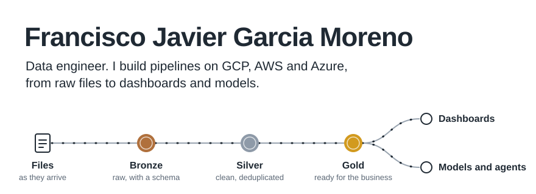

<picture>
  <source media="(prefers-color-scheme: dark)" srcset="assets/pipeline-en-dark.svg">
  
</picture>

English | [Español](README.es.md)

Data engineer with 5+ years designing ETL/ELT pipelines and medallion architectures on GCP, AWS and Azure for the financial, retail, logistics and education sectors. I take data from ingestion to analysis and models in production, with automated tests and controlled deployment.

[Portfolio](https://javiermorenof7.github.io/cv_portafolio/) | [LinkedIn](https://www.linkedin.com/in/francisco-javier-garcia-moreno-78b184166)

## Projects

Each folder in this repository is a case I worked through end to end. The data in all of them is fictional.

### Pipelines on Google Cloud

| Project | What it does |
| --- | --- |
| [FinTrust data pipeline](caso_gcp_fintrust) | Replaces manual report downloads at a consumer-credit fintech with an automated pipeline in BigQuery, with documented technical decisions and data-quality evidence. |
| [Health data ingestion](analisis_gcp) | Loads CSV, TXT and Excel files from Cloud Storage into bronze and silver layers in BigQuery. Cloud Composer (Airflow) runs it, and every load is idempotent. |
| [Seguros AltaVida](seguros_altavida) | Data processing, machine learning and a cloud architecture to take a health insurer's analytics from one-off solutions to production. |
| [Sales architecture](area_ventas) | Takes a sales workbook from a local Excel file to an architecture on Google Cloud that scales. |

### Pipelines on AWS

| Project | What it does |
| --- | --- |
| [Academic calendars on Databricks](calendarios_databricks_aws) | Takes the calendars that partner universities drop in S3 through bronze, silver and gold Delta tables on Databricks. Files that have not changed are skipped, and rows that cannot be used are set aside with the reason. |

### AI

| Project | What it does |
| --- | --- |
| [Banking and e-commerce agent](ecomerce_agent) | An assistant that checks a product's price against the customer's balance before recommending it. It combines semantic search over the catalogue (FAISS) with the customer's own data, built with LangChain. |

### Analysis

| Project | What it does |
| --- | --- |
| [Credit risk](riesgo_credito) | Intermediation rates across banks, by entity type, credit type and term, to support a funding strategy. |
| [Absenteeism at a manufacturer](analisis_company) | A dimensional model and a single analysis table to explain how absences affect productivity. |
| [Product recommendations](analisis_probabilistico_tiendas) | A probabilistic analysis of whether one product is a good recommendation for another. |
| [Cleaning and transformation](limpieza_trasformacion) | A notebook that turns a messy Excel file into a clean dataset. |

## How it runs

- Each folder is a standalone project with its own README: what it solves, how to run it and its sample data.
- Environment: Python 3.12 and `pip install -r requirements.txt` in a virtual environment. Cloud projects (Google Cloud, Databricks) also need their own account and setup, described in their README.
- Every push to `main` goes through CI: it checks the syntax of every Python file and that every notebook is valid.

## Tools

| Area | What I use |
| --- | --- |
| Languages | Python, SQL, Scala, PySpark |
| Data platforms | Databricks, BigQuery, Delta Lake, Unity Catalog, Redshift, Synapse, PostgreSQL |
| Cloud | Google Cloud, AWS, Azure |
| Orchestration | Airflow (Cloud Composer, MWAA), Azure Data Factory, Databricks jobs |
| Analytics and AI | Power BI, Tableau, Looker Studio, Pandas, Scikit-learn, NLTK, LangChain, FAISS, Vertex AI |
| Practices | Medallion architecture, incremental MERGE loads, idempotent loads, data quality, dimensional modeling (star schema), automated SQL tests, Git and merge requests |
