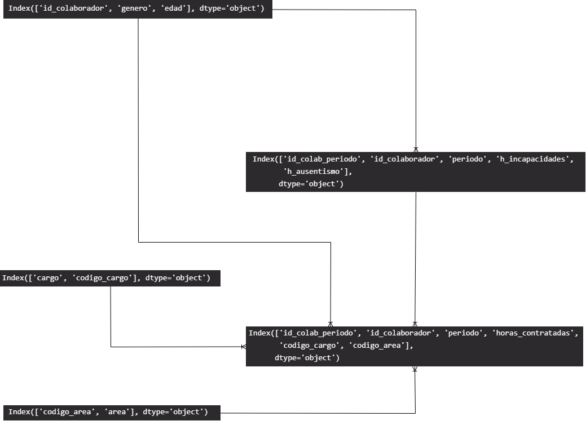
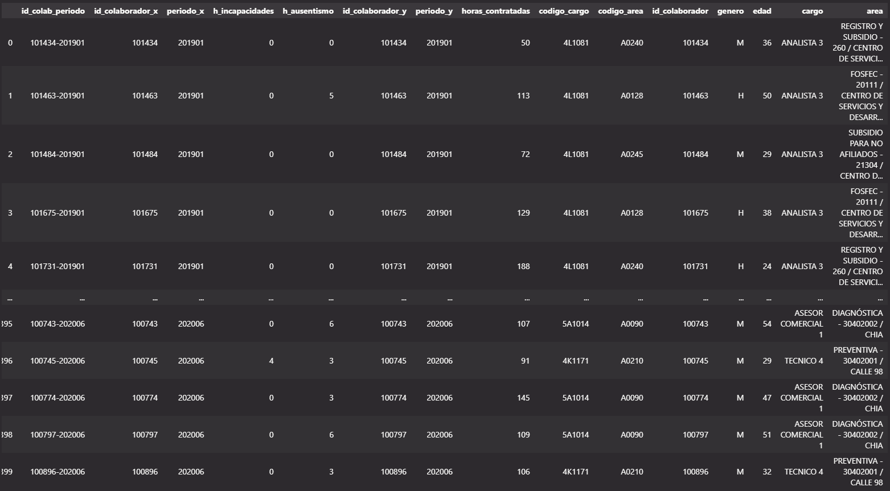
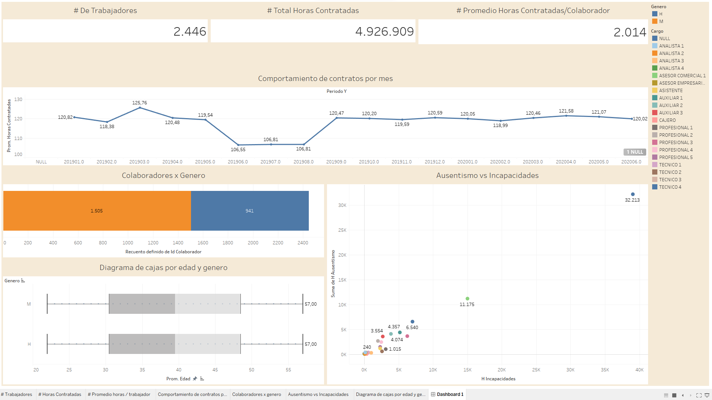

# Introducción

  La empresa The Best Company dedicada a producir repuestos automovilísticos, conoce que la baja productividad de sus colaboradores está dada en gran medida por los ausentismos a las jornadas laborales. Para realizar un análisis de ello y comprobarlo, requiere del apoyo del Consultor en Analítica (usted), con el fin de establecer los principales patrones de comportamiento de los colaboradores, respecto a su cargo y áreas de trabajo, las horas contratadas y los ausentismos o incapacidades que puedan tener.

# Data

- Colaboradores.xlsx: Cuenta con el listado de colaboradores de la compañía y algunos datos demográficos.

- Cargos.txt:   Tabla paramétrica con los cargos existentes en la compañía.

- Areas.csv:    Tabla paramétrica con las áreas (sedes) existentes en la compañía.

- Horas_Contratadas.csv: Tabla histórica con la información de horas contratadas para cada persona en su respectivo cargo y área (Periodo de tiempo de ene19 – jun20).

- Ausentismo_Incapacidades.xlsx:    Tabla histórica con la información de horas de ausentismo y horas de incapacidades, para cada persona (Periodo de tiempo de ene19 – jun20).

# Modelo dimensional

# Modelo obtener la tabla de análisis

 Para poder obtener un análisis que pueda producir y responder las preguntas para entender los datos, es necesario llegar a una tabla que unifique directamente la base de datos relacional, la cual podemos obtener con el archivo company.ipynb (Este modelo también se puede importar a una base de datos)

la tabla unificada o la tabla final es la siguiente:

la data descargable la podemos obtener del siguiente link

> https://raw.githubusercontent.com/javiermorenof7/javiermorenof7/main/analisis_company/data/data_tableau.csv

# Visualización

Una vez obtenida esta tabla podemos realizar los siguientes análisis

> https://public.tableau.com/app/profile/francisco2414/viz/Company_16655277589250/Dashboard1

# Datos reales: Absenteeism at work

Para contrastar el caso con ausencias reales, el proyecto procesa [Absenteeism at work](https://archive.ics.uci.edu/dataset/445/absenteeism+at+work) del UCI Machine Learning Repository: 740 registros de ausencias en una empresa de mensajería de Brasil, entre julio de 2007 y julio de 2010, de 36 empleados anonimizados con un número. Licencia [CC BY 4.0](https://creativecommons.org/licenses/by/4.0/deed.es).

- `procesamiento/ingesta_ausentismo.py` (bronce): baja el conjunto y deja un archivo de control con las filas y la huella SHA-256. Si ya está en bronce, no vuelve a descargar.
- `procesamiento/capas_ausentismo.py` (plata y oro): traduce las columnas, aparta los registros que no son ausencias y arma un modelo dimensional: `dim_empleado`, `dim_motivo` (los 21 capítulos de la CIE-10 y 7 motivos más, como consulta médica o donación de sangre) y `hecho_ausencia`.

| Resultado | Registros |
| --- | ---: |
| Aceptada | 696 |
| Registro sin ausencia (motivo 0 y 0 horas) | 43 |
| Ausencia sin horas | 1 |

Hay 34 registros idénticos a otro. Como la fuente no trae la fecha exacta, solo el mes y el día de la semana, no se puede probar que sean la misma ausencia: se conservan y se dejan contados en `resumen_capas.csv`.

Algunos resultados: 5.124 horas perdidas entre 33 empleados. Las enfermedades osteomusculares (842 horas) y las lesiones (729) son las que más horas quitan; la consulta médica es el motivo más frecuente (149 ausencias). El lunes se pierden 1.489 horas, casi el triple que el jueves (553).

Los resultados están en `data/oro/`: las dimensiones, el hecho y las horas por motivo, mes y día de la semana. Para correrlo: `python analisis_company/procesamiento/ingesta_ausentismo.py` y después `python analisis_company/procesamiento/capas_ausentismo.py`.
