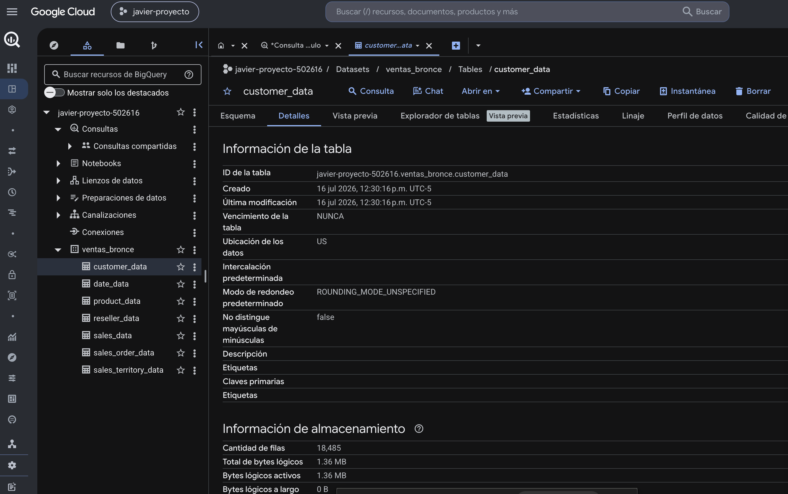

# Arquitectura de ventas

Cómo pasar un libro de ventas en Excel (AdventureWorks Sales) de un archivo local a una arquitectura en Google Cloud que escale: modelo en estrella, capas bronce, plata y oro, y el análisis del top 10 de productos por categoría.

El detalle completo está en [arquitectura/arquitectura.md](arquitectura/arquitectura.md).

## Contenido

| Ruta | Qué contiene |
| --- | --- |
| [arquitectura/arquitectura.md](arquitectura/arquitectura.md) | Diseño de la solución, stack propuesto, análisis de negocio y plan de trabajo del MVP. |
| [arquitectura/arquitectura.py](arquitectura/arquitectura.py) | Exporta cada hoja del Excel a un CSV con cabeceras válidas para BigQuery. |
| [arquitectura/arquitecturagcp.py](arquitectura/arquitecturagcp.py) | Carga cada hoja del Excel directamente en BigQuery. |
| [data/](data) | `AdventureWorksSales.xlsx`, el libro de origen. |
| [capturas/](capturas) | Diagrama de la arquitectura y resultado del top 10. |
| [procesamiento/](procesamiento) | Ingesta y capas plata y oro de las ventas reales de Online Retail II. |
| [data/oro/](data/oro) | Resultados agregados de las ventas reales. |

## Datos reales: Online Retail II

Además del libro de AdventureWorks, el proyecto procesa [Online Retail II](https://archive.ics.uci.edu/dataset/502/online+retail+ii) del UCI Machine Learning Repository: 1.067.371 líneas de factura reales de un minorista en línea del Reino Unido, entre diciembre de 2009 y diciembre de 2011, con importes en libras esterlinas. Licencia [CC BY 4.0](https://creativecommons.org/licenses/by/4.0/deed.es). El cliente llega como un número anónimo.

- `procesamiento/ingesta_ventas.py` (bronce): baja el libro, une sus dos hojas en un CSV que guarda la hoja de origen, y deja un archivo de control con las filas por hoja y la huella SHA-256. Si ya está en bronce, no vuelve a descargar.
- `procesamiento/capas_ventas.py` (plata y oro): aplica las reglas en orden, cada línea queda con el primer motivo que cumple, y comprueba que las filas cuadran entre bronce y plata. Las facturas que empiezan por `C` son devoluciones: se conservan con importe negativo.

| Resultado | Líneas |
| --- | ---: |
| Aceptada | 1.021.127 |
| Repetida en las dos hojas del libro (1 al 9 de diciembre de 2010) | 22.523 |
| Línea duplicada | 11.812 |
| Cargo o ajuste, no es producto (`POST`, `M`, `BANK CHARGES`...) | 5.981 |
| Precio en cero o negativo | 5.928 |

El hallazgo que más pesa: la hoja 2009-2010 repite las 1.088 facturas del 1 al 9 de diciembre de 2010, que también están en la hoja 2010-2011. Sin esa regla, esas ventas se contarían dos veces.

Algunos resultados: ventas netas de 18,9 millones de libras, con un 3,65 % devuelto; el mejor mes fue noviembre de 2011 (1,43 millones); el Reino Unido concentra el 85,4 % de las ventas netas entre 43 países, y el 22,2 % de las líneas no trae cliente identificado. Diciembre de 2011 llega solo hasta el día 9.

La capa oro (`data/oro/`) trae las ventas mensuales, las ventas por país, el top 20 de productos y el maestro de productos (un código puede llegar con varias descripciones; queda la más usada). Bronce y plata se regeneran con los scripts y no se versionan; `data/online_retail_ii_2011_12_09.csv` es una muestra de bronce. Para correrlo: `python area_ventas/procesamiento/ingesta_ventas.py` (leer el Excel necesita `openpyxl`) y después `python area_ventas/procesamiento/capas_ventas.py`.
