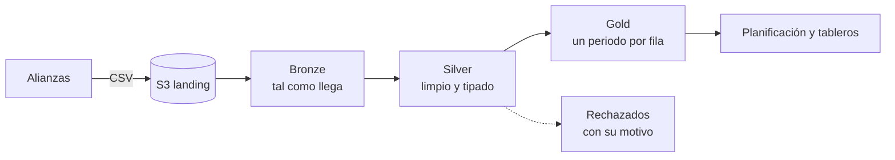

# Calendarios académicos en Databricks sobre AWS

Aulaviva es una empresa ficticia que opera programas en línea junto con universidades aliadas. Cada alianza publica su calendario (cohortes, periodos y asignaturas) en un archivo propio, con su propio formato de fechas y sus propios descuidos. Este proyecto reúne esos archivos en una sola tabla confiable para planificación.

Los datos, las alianzas y los nombres de catálogos y buckets son inventados.

## Arquitectura



| Pieza | Para qué se usa |
| --- | --- |
| Amazon S3 | Bucket de aterrizaje donde cada alianza deja su CSV: `s3://aulaviva-<entorno>-landing/calendarios/`. |
| AWS IAM | Un rol con permiso de lectura sobre ese bucket. Databricks lo asume a través de una *external location* de Unity Catalog, así que el código no lleva llaves. |
| Databricks | Tres notebooks de PySpark en cómputo serverless, encadenados en un job diario. |
| Delta Lake y Unity Catalog | Tablas de las tres capas, en un catálogo por entorno: `aulaviva_dev` y `aulaviva_prod`. |

## Capas

| Capa | Tabla | Qué contiene |
| --- | --- | --- |
| Bronze | `bronze.calendario` | Las filas de los CSV como texto, con el archivo de origen, su huella y la fecha de ingesta. |
| Bronze | `bronze.control_calendario` | Una fila por cada versión cargada de cada archivo. |
| Silver | `silver.calendario` | La versión vigente de cada archivo, sin espacios sobrantes ni duplicados, con fechas y semanas calculadas. |
| Silver | `silver.calendario_rechazados` | Las filas que no se pueden usar y el motivo. |
| Gold | `gold.calendario_periodos` | Una fila por alianza, programa, cohorte y periodo: inicio, fin, semanas y número de asignaturas. |

## Decisiones

- **Bronze solo agrega cuando algo cambió.** De cada archivo se calcula una huella SHA-256 de su contenido y se compara con la última guardada. Ejecutar el job diez veces sobre los mismos archivos deja las tablas igual que ejecutarlo una, y cuando una alianza corrige su calendario queda el histórico de versiones.
- **Bronze no interpreta nada.** Todo se guarda como texto. Si una regla de limpieza resulta estar mal, Silver se reconstruye sin volver a S3.
- **Las filas malas no se pierden ni detienen la carga.** Una fecha ilegible o un periodo que termina antes de empezar va a la tabla de rechazados con su motivo, y el resto del calendario sigue su camino.
- **Gold valida antes de publicar.** Si dos periodos de una misma cohorte se solapan, el notebook falla y la tabla anterior queda intacta.
- **Todo corre en serverless.** El job no declara ningún clúster, así que Databricks ejecuta las tres tareas en cómputo serverless: no hay máquinas que dimensionar ni que apagar, y se paga solo el tiempo de ejecución. Por eso los notebooks usan únicamente la API de DataFrames y evitan lo que serverless no admite, como `cache()`, RDD o rutas montadas.
- **El entorno es un parámetro.** Los notebooks reciben `entorno` (`dev` por defecto) y de ahí salen el catálogo y el bucket. No hay nombres de producción escritos a mano.

## Estructura

```
notebooks/bronze.py     S3 a Bronze, con control de cambios por huella
notebooks/silver.py     limpieza, tipos y filas rechazadas
notebooks/gold.py       resumen por periodo y validación
sql/validaciones.sql    consultas para revisar las tablas tras una ejecución
databricks.yml          job de tres tareas (Databricks Asset Bundle)
data/                   un calendario de muestra por alianza
```

Los tres notebooks siguen el mismo orden: librerías y logs, entorno, configuración, funciones, proceso y validación.

## Datos de muestra

| Archivo | Qué trae |
| --- | --- |
| `altamar.csv` | Limpio, con fechas `yyyy-MM-dd`. |
| `monteverde.csv` | Fechas `dd/MM/yyyy`, espacios de más y una asignatura repetida. |
| `rioclaro.csv` | Una fecha sin definir y un periodo que termina antes de empezar. |

Con estos archivos, las 19 filas de Bronze pasan a 16 válidas y 2 rechazadas en Silver (la restante era la repetida), y a 9 periodos en Gold.

## Cómo ejecutarlo

Hace falta un workspace de Databricks en AWS con Unity Catalog, el catálogo `aulaviva_dev` creado, una *external location* sobre el bucket y la CLI de Databricks configurada.

```bash
# 1. Subir los calendarios de muestra al bucket
aws s3 cp data/ s3://aulaviva-dev-landing/calendarios/ --recursive

# 2. Desplegar el job y ejecutarlo
databricks bundle deploy -t dev
databricks bundle run calendarios -t dev
```

Después, `sql/validaciones.sql` muestra qué se cargó, qué se rechazó y el calendario final. Para producción se usa `-t prod`, que apunta a `aulaviva_prod` y a su bucket.
