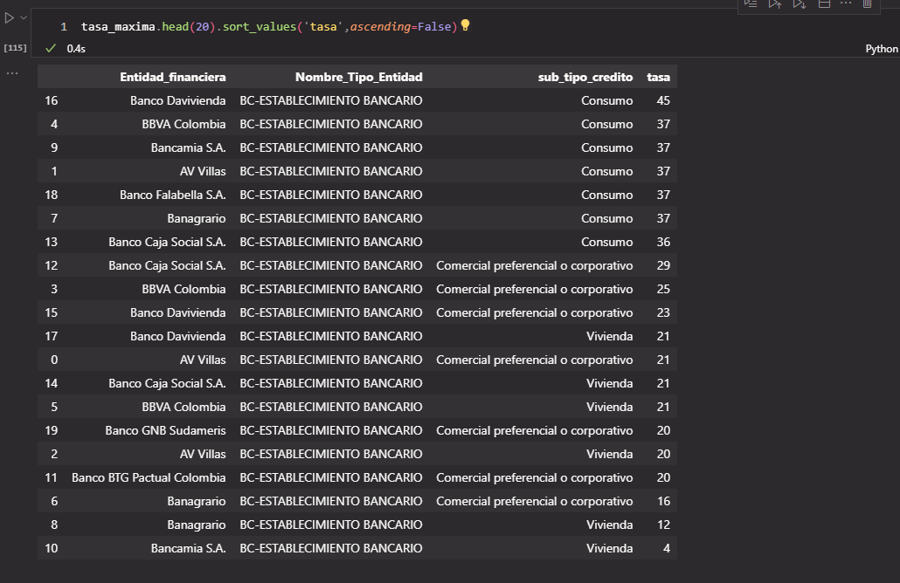
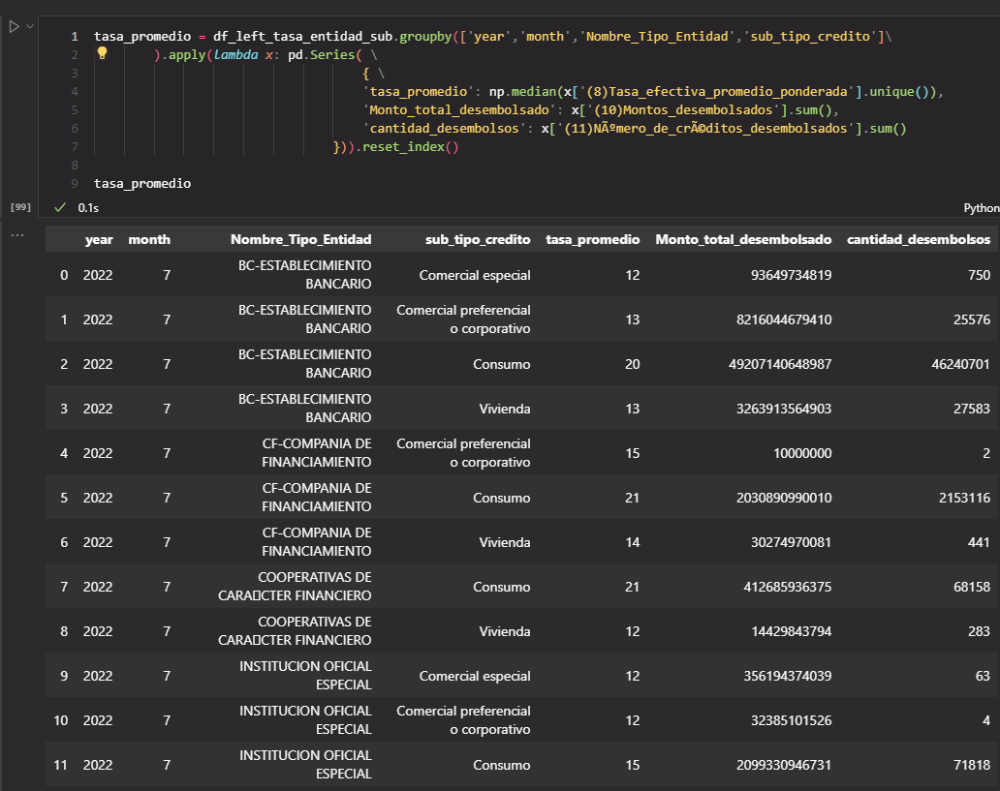
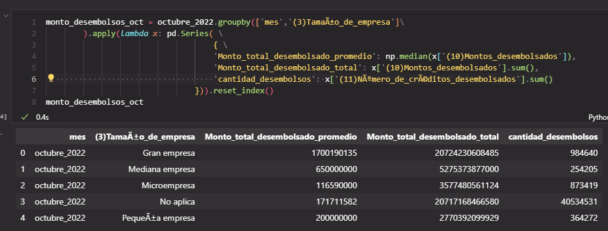
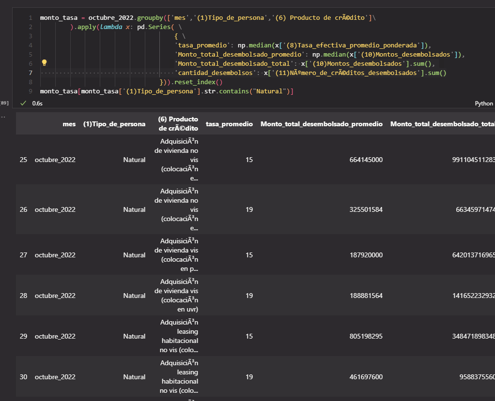
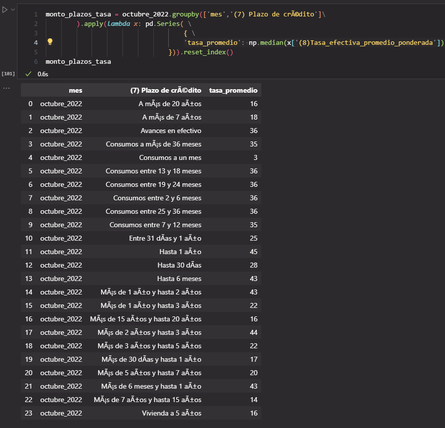
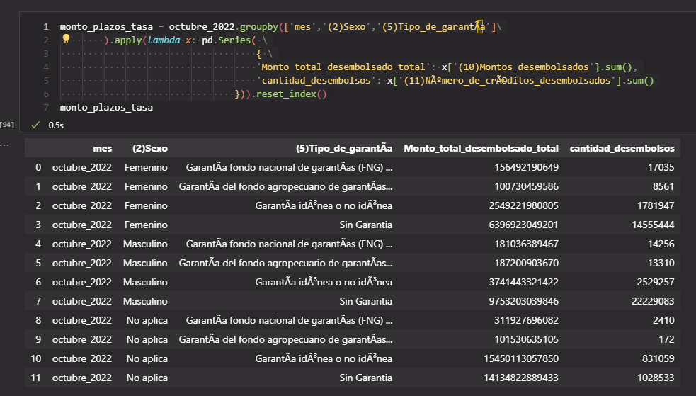

# Riesgo de credito

La gerencia quiere conocer algunos aspectos correspondientes a las tasas de intermediación del sector bancario para trabajar en su estrategia de fondeo y costo de crédito.

## Los datos están compuestos por las siguientes tablas:

- Detalle_tasas
- Tipo_entidad
- Entidades
- Tipo_credito
- Plazos

# 5 entidades financieras con la mayor tasa de intermediación clasificadas por entidad financiera, tipo de entidad y subtipo de crédito. 

# promedio de la tasa de intermediación por tipo de entidad financiera, tipo de crédito para uno de los meses entregados.

# periodo octubre 2022

## el monto total de desembolsos y promedio de la tasa agrupados por tamaño de la empresa.

## el monto total de desembolsos y el promedio de la tasa para persona natural y clasificarlos por Producto de Crédito

## Distribución de los plazos y el promedio de la tasa para cada uno de ellos.

## Cantidad de desembolsos realizados y monto total, distribuidos por sexo, tipo de garantía y mes.

# Reporte

El reporte generado se puede descargar en el siguiente link

https://raw.githubusercontent.com/javiermorenof7/javiermorenof7/main/riesgo_credito/data/reporte_consolidado.csv

AWS 

 - Amazon Elastic Compute = Permite Alquilar Aplicaciones para realizarlas en la Nube
 - Amazon Glue = ADministracion de recursos en la nube
 - Amazon Athena = interaccion de analisis de datos en amazon S3 con SQL es muy similar a big query de Google

# Datos reales: informe semanal de tasas de interés activas (2002-2022)

Para ver las tasas en el tiempo, el proyecto procesa el [informe semanal de tasas de interés activas](https://www.datos.gov.co/d/yvb2-ppaa) que publica la Superintendencia Financiera de Colombia en datos.gov.co: tasa efectiva anual, montos y número de créditos desembolsados por entidad y tipo de crédito, cada semana desde mayo de 2002 hasta junio de 2022. Son 732.673 filas con licencia [CC BY-SA 4.0](https://creativecommons.org/licenses/by-sa/4.0/deed.es).

- `procesamiento/ingesta_tasas.py` (bronce): baja el conjunto desde la API del portal, paginado con un orden estable, y guarda un archivo de control con las filas, la fecha de actualización del portal y la huella SHA-256. Si el portal no cambió, no vuelve a descargar.
- `procesamiento/capas_tasas.py` (plata y oro):
  - Corrige el texto que llega con la codificación dañada (`ADQUISICIÓN` pasa a `ADQUISICIÓN`).
  - Deja una fila por semana, entidad, modalidad y plazo: la misma entidad aparece con dos nombres en una semana (`Banco De Bogota` y `Banco De Bogota S.A.`) y se repite.
  - Marca como faltante el número de créditos antes de 2011, que la fuente deja en 0 porque no lo reportaba.
  - Aparta las filas que no sirven para promediar y comprueba que las filas cuadran entre bronce y plata.
  - Calcula las tasas mensuales ponderadas por el monto desembolsado y el margen de intermediación: tasa de crédito menos tasa de ahorro.

| Resultado | Filas |
| --- | ---: |
| Aceptada | 705.499 |
| Tasa en cero | 27.100 |
| Duplicada por cambio de nombre de la entidad | 66 |
| Sin monto desembolsado | 8 |

Algunos resultados:

- Entre mayo de 2002 y febrero de 2013 el margen de intermediación estuvo entre 10,1 y 17,1 puntos (mediana de 14,5). La fuente publica las tasas de ahorro solo hasta febrero de 2013, así que el margen no va más allá.
- En junio de 2022, el crédito de consumo de bajo monto tuvo la tasa ponderada más alta (44,3 %), seguido del microcrédito (40,2 %); la vivienda tuvo la más baja (10,3 %).

La capa oro (`data/oro/`) trae las tasas por modalidad y mes, el margen de intermediación y las tasas por tipo de entidad y año. Las capas bronce y plata se regeneran con los scripts y no se versionan; `data/tasas_semanal_2022_06_24.csv` es una muestra de bronce. Para correrlo: `python riesgo_credito/procesamiento/ingesta_tasas.py` y después `python riesgo_credito/procesamiento/capas_tasas.py`.
